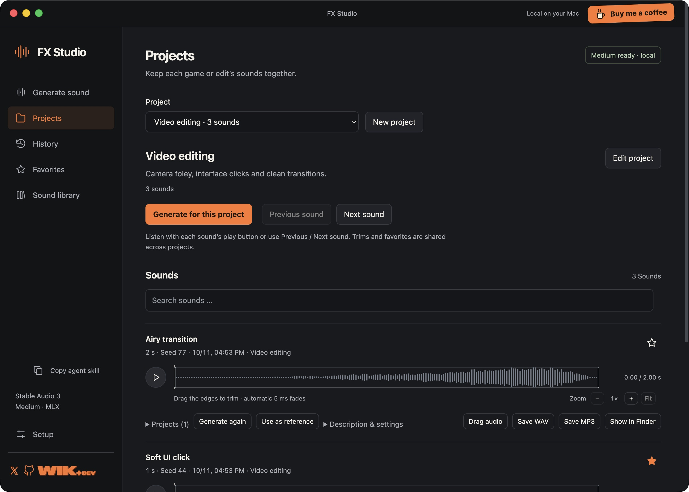
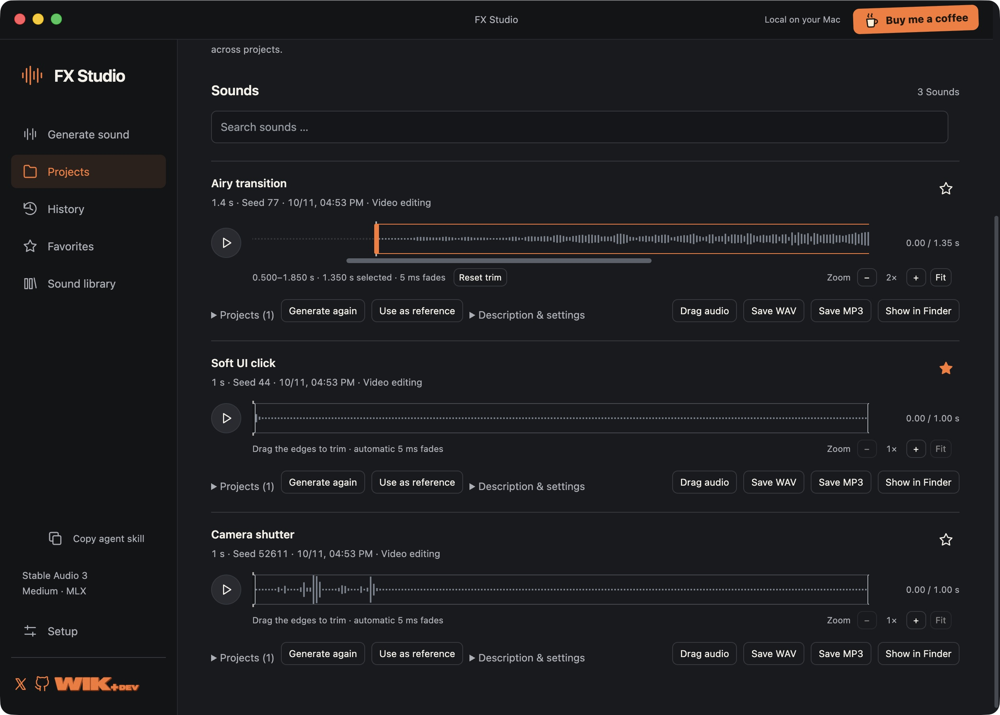
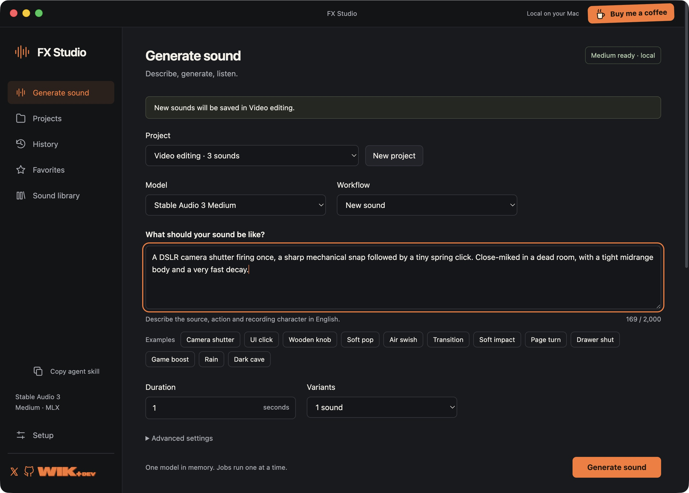

# FX Studio

**Create sound effects locally. Let your coding agent create them too.**

FX Studio is a desktop app for sound effects powered by **Stable Audio 3 Medium**. Describe a camera shutter, UI click, transition or game action, generate several takes, audition them, trim the waveform and drag the result into your editor.

A local agent can create a project, generate a named sound pack and export the finished assets through **MCP**, the local API or an installable skill. Its sounds appear in the same app, ready for you to review.

Built by [WIK+DEV](https://wikplus.dev/) · [X / @wik_plus](https://x.com/wik_plus) · [Buy me a coffee](https://buymeacoffee.com/wikplus)



Screenshots show real Medium output in a separate demo project.

## Download and install

Get the compiled app from **[GitHub Releases](https://github.com/WikPlus/FXStudio/releases)**. GitHub's **Code → Download ZIP** contains source code, not an installed app.

| Platform | Download | Generation engine | Status |
| --- | --- | --- | --- |
| macOS 26.2+, Apple Silicon | `FXStudio-macOS-arm64.zip` | Official MLX | Tested on an M1 Pro with 16 GB unified memory |
| Windows 10/11, x64 | `FXStudio-Windows-x64-Setup.exe` or portable ZIP | Official LiteRT, CPU | Native CI acceptance in progress; see [Actions](https://github.com/WikPlus/FXStudio/actions/workflows/windows.yml) |

Intel Macs, Windows ARM and Linux are not supported by these packages. Windows uses quantized Medium weights; its speed and output are not identical to MLX. A small test clip is not a promise of performance on every computer.

### macOS

This package requires **macOS 26.2 or newer** because of its bundled MLX native libraries. The minimum is read from the actual bundled binaries, rather than inherited from Electron.

1. Download and unzip `FXStudio-macOS-arm64.zip`.
2. Move **FX Studio.app** into **Applications**.
3. Open it. If macOS blocks the unsigned developer, try **System Settings → Privacy & Security → Open Anyway**, then confirm the app you downloaded. See [Apple's instructions](https://support.apple.com/en-us/102445). The app is not notarized.
4. Let the first-launch model download finish. You can pause or retry it inside the app.

No Terminal, Homebrew, Node.js or separate Python installation is needed to use the compiled app.

### Windows

Download the Setup EXE from a release that includes a tested Windows asset. Run it to install for your user; administrator rights are not required. The portable alternative is `FXStudio-Windows-x64.zip`: extract the **whole folder**, then open **FX Studio.exe**. Keep `resources` and the other files beside it.

Windows packages are unsigned. Check the release's checksum and download source before deciding whether to allow a Windows reputation warning. Do not disable your computer's protection globally.

### The model downloads automatically

Only **Stable Audio 3 Medium** is used. Weights are downloaded separately from Stability AI's pinned Hugging Face release when the app first opens. Setup shows real download progress, missing files, disk space, pause/resume and errors. Existing complete files and the local cache are reused. After setup, generation works offline.

| Model download | Disk space for weights and text encoder |
| --- | --- |
| Mac / MLX | **6.41 GiB** (6.88 GB) |
| Windows / LiteRT | **about 2.99 GiB**, quantized w8a8 |

These are download/storage sizes, **not measured RAM requirements**. Leave additional space for the app, temporary downloads and generated audio. If upstream access requires authorization, the app reports the actual access error; it cannot accept agreements for you.

The **application source is MIT licensed**. The downloaded model has separate Stability AI Community License and Gemma terms. Review [model and third-party terms](THIRD_PARTY_NOTICES.md) before use; “open-source app” does not mean the model weights are MIT licensed.

## What you can do

- Generate **0.5–30 second** stereo sound effects at **44.1 kHz**, with 1–4 variants.
- Create projects for a game, video or asset pack. Review takes with Previous/Next, favorites and search.
- Play, seek and zoom the real waveform. Drag either edge to trim; crops get automatic **5 ms fades**. The original audio remains available.
- Drag the **saved crop** into an editor, or export WAV and 320 kbps MP3. Stable drag-export files survive app restarts and later trim changes.
- Make variations from an existing sound or regenerate a selected section.
- Queue jobs, see actual progress/errors and cancel generation. One worker runs at a time and releases its model memory when it exits.
- Use the same workflow from local agents, with named packs, project membership and export manifests.

Sounds, projects, seeds, settings, trims and favorites persist locally. There are no subscriptions, purchase gates, public generation endpoints or cloud agent connections.



## Get cleaner results

Start at **8 steps, CFG 1**, then make 2–4 variants and listen. More steps and higher CFG do not automatically improve a take. At CFG 1, a negative prompt has no effect.

Use one concrete event per asset: **source → action/event count → texture and decay → recording perspective and room**. For close foley, specify a dry recording. Match the requested duration to the event, then trim the actual result. These original examples follow the [official Stable Audio 3 prompt guide](https://stability.ai/guides/stable-audio-3-prompt-guide):

**Camera shutter — 1 second**

> A DSLR camera shutter firing once. A crisp mechanical snap followed by a tiny spring click, with a compact midrange body and a very fast decay. Recorded close to the mechanism in an acoustically dead room.

**UI click — 1 second**

> A single soft synthesized UI tap. A rounded midrange tick with a delicate bright attack and a very short, smooth decay. Dry and isolated.

**Transition — 2 seconds**

> A quick airy whoosh sweeping past the microphone once. A smooth rising rush of air with a soft low body, a bright peak and a short clean tail. Close, dry studio sound design.

**Wooden door — 2 seconds**

> A small wooden cabin door pushed shut once. A compact wooden knock followed by a short latch click, with a warm low-mid body and a quick natural decay. Recorded close in a quiet, dry room.

**Page turn — 2 seconds**

> One page of a thick paper notebook turned slowly. A light papery scrape, a brief rustle and a soft settling tap. Recorded very close in a quiet room with little reverberation.

More examples are included in the app and [English agent skill](ui/skills/fx-studio/SKILL.md). A fixed seed helps compare changes; a blank seed creates fresh takes. Audition the results: prompts cannot guarantee an exact event placement or perfect sound quality.



## Use with a local agent

1. Install/open the app. In **Setup → Local agents**, enable access and choose an export folder.
2. Click **Install skill… → Codex**, or choose another local agent's skills folder. Start a new agent conversation. **Save agent kit…** exports the skill, helper and configuration recipes for your current installation.
3. Ask the agent, for example:

> Use FX Studio to create a project called Forest game. Generate two variations each of a soft UI select, a wooden door closing and a player landing on grass. Keep the sounds dry and short. Export the selected assets as WAVs and tell me which takes you were able to audition.

The skill includes concrete prompts, settings, project creation, polling, cancellation, trimming and exports. It supports a command-line fallback for agents that can run local commands. No extra Python install is required: the app includes its own interpreter. Agents must be able to access this computer; a skill alone does not give a cloud agent access to your Mac or PC.

### MCP

In Setup, **Copy MCP config** gives standard `mcpServers` JSON; **Copy Codex config** gives TOML for `~/.codex/config.toml`. Paste the generated configuration into the local client's MCP settings, then reload it. Paths are specific to where you installed the app. The stdio adapter reads its local private credential automatically; never paste an API key into a prompt or public configuration.

There are **20 tools**: status and prompt guide; sound/pack generation, polling and cancellation; history/library search; sound inspection, trimming, favorites and exports; project creation, updates and sound membership. The guide is also exposed as `fxstudio://guide`.

Agent-created jobs appear in the desktop queue. Pack creation returns immediately; poll the returned IDs. Finished takes are saved in the selected project, and exported packs include a manifest with prompts, settings, seeds, trims and provenance.

### API / CLI

The authenticated local API is at `http://127.0.0.1:3921/agent/v1`. Access starts **off**, can be disabled or reset in Setup, and exports stay within the folder you selected. The service binds only to loopback. Generation does not have a short fixed timeout.

For complete routes, examples, CLI commands and client setup, read **[AGENT-ACCESS.md](AGENT-ACCESS.md)**. The installable skill source is **[ui/skills/fx-studio](ui/skills/fx-studio)**.

## Your data

| Platform | App data |
| --- | --- |
| macOS | `~/Library/Application Support/FX Studio/` |
| Windows | `%LOCALAPPDATA%\FX Studio\` |

Generated audio is in `audio/`; projects/history/favorites/trims are in `studio.sqlite`; crop caches are in `edits/`; stable editor references are in `drag-exports/`; logs are in `jobs/` and `service.log`. Model links/files are in `models/`. Keep drag-export files while your editor still references them. Removing/reinstalling the app does not remove this data folder.

No personal sound library is included. An optional catalog can be connected using `FX_LIBRARY_ROOT` or an absolute path in `library-root.txt` in the app data folder. Without configuration the app looks in `~/Music/FX Studio Library`. It expects `katalog.json` with existing `assets[].path` entries and provenance; it reads those files in place and retains documented/unknown rights. Generated sounds work independently of this optional library.

## Build from source

End users should use Releases. Developers need Git, Node.js/npm and [uv](https://docs.astral.sh/uv/).

```sh
git clone https://github.com/WikPlus/FXStudio.git
cd FXStudio
```

**Apple Silicon Mac:** install Xcode Command Line Tools. `./Einrichten.command` prepares the pinned official MLX runtime, Python dependencies, Electron and Medium weights; `npm start` launches development mode. To build a standalone release, install `pkg-config` and shared LAME 3.100, then:

```sh
npm run prepare:release
npm test
npm run check
npm run build
npm run package:mac
```

The collector requires the bundled upstream license materials and exact pinned native versions. Read [release engineering](packaging/GITHUB-RELEASE.md) before rebuilding native libraries.

**Windows x64:** the included [GitHub Actions workflow](.github/workflows/windows.yml) provisions the build tools, compiles native audio components, installs the official LiteRT runtime, runs behavior/runtime/installer tests and uploads tested packages. For a local build, install MSYS2 at `C:\msys64` with the packages listed in the workflow, and Inno Setup 6, then run `./Build-Windows.ps1` in PowerShell. A custom native build must supply matching license/source evidence.

Normal CI does not download model weights. A manually dispatched run can explicitly enable a temporary real Medium generation test. Test fixtures create disposable synthetic audio to check behavior; they are not presented as generated examples. CI reports distinguish runtime/export checks from actual model inference.

## License and support

[MIT](LICENSE) for FX Studio's original code, documentation and agent skill. See [NOTICE](NOTICE) and [THIRD_PARTY_NOTICES.md](THIRD_PARTY_NOTICES.md) for bundled software, model terms and corresponding native-library sources. Setup can open all bundled licenses offline.

Report reproducible problems in [Issues](https://github.com/WikPlus/FXStudio/issues), including platform, app version and the error. Remove prompts, personal paths and credentials from shared logs. Contributions are welcome; test the behavior you change and keep model weights, user audio and secrets out of Git.

If it helps your workflow, you can [buy me a coffee](https://buymeacoffee.com/wikplus).
